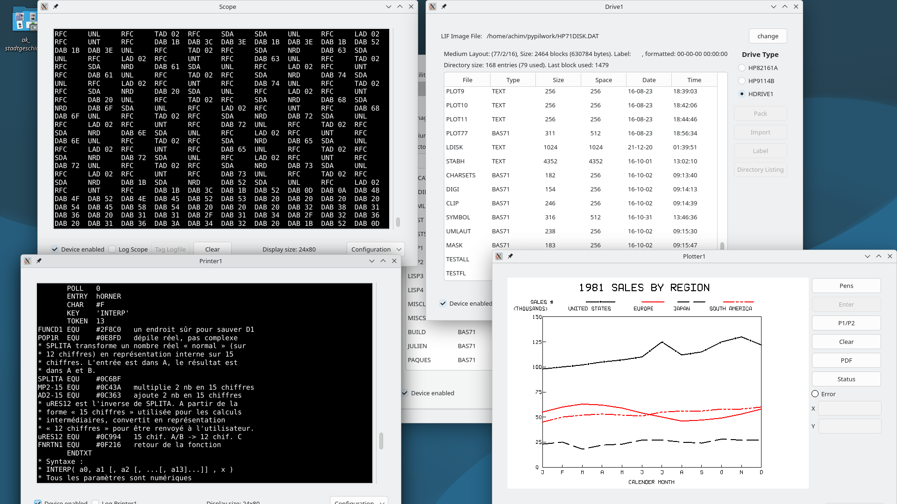
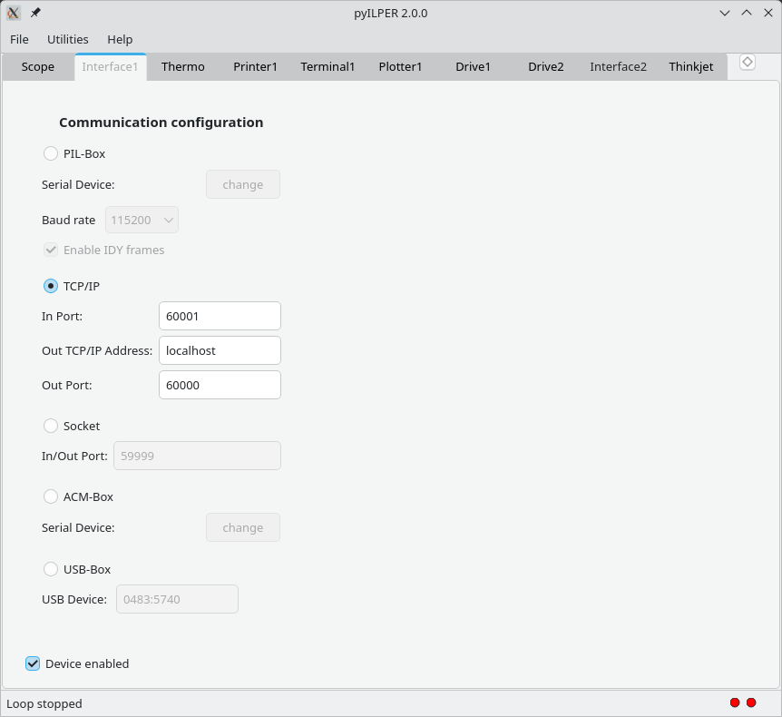
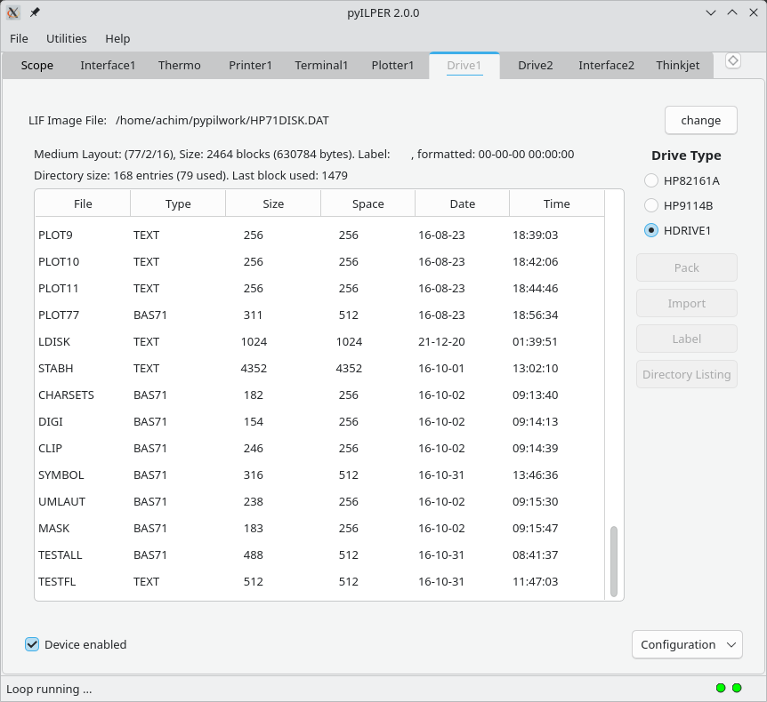
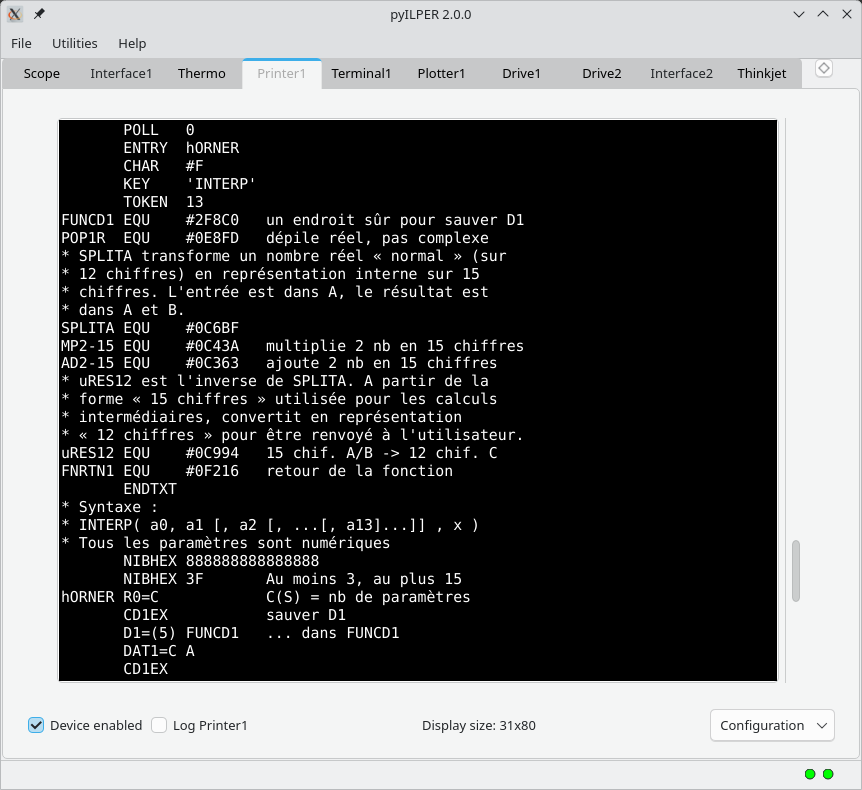
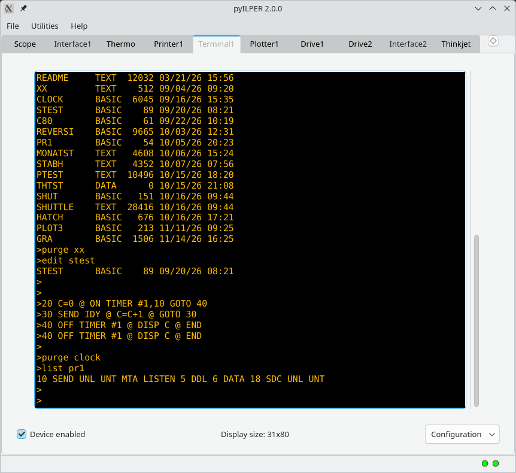
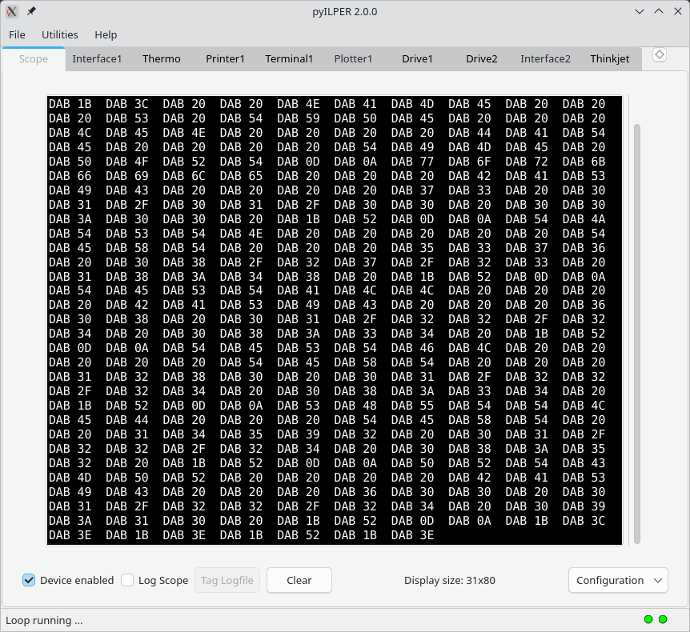
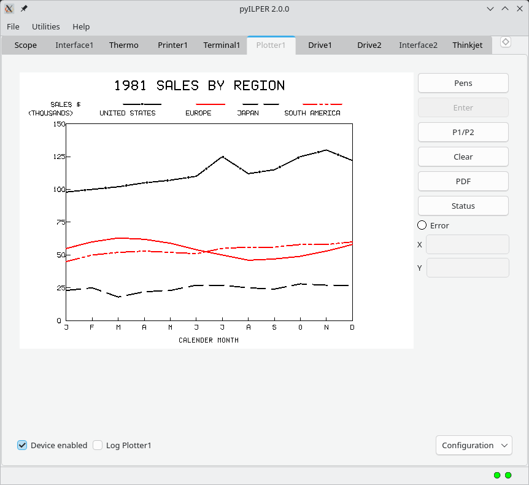
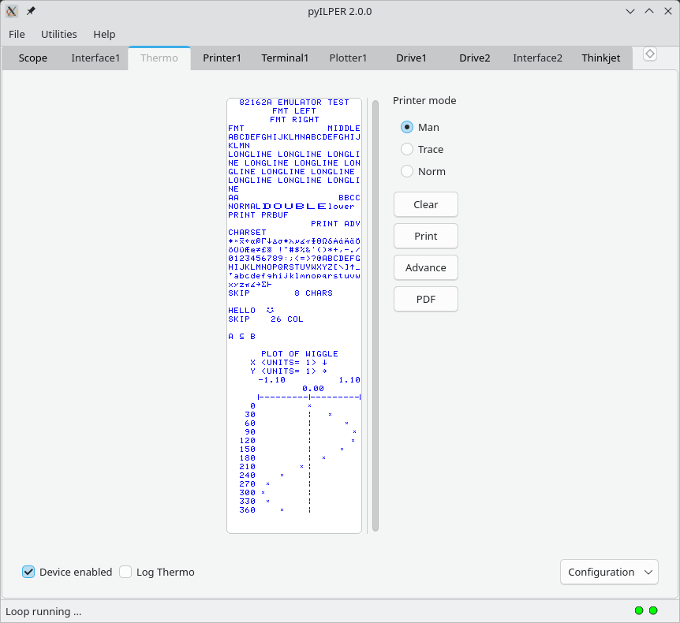
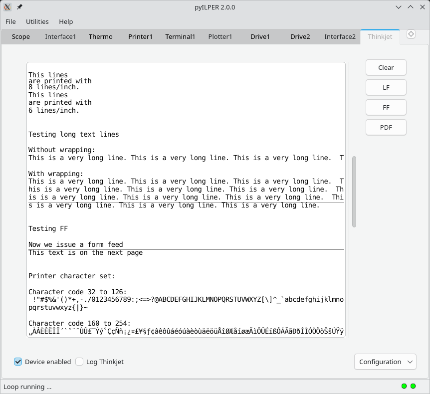

pyILPER virtual devices gallery
===============================

Index
-----

* [Graphical User Interface](#graphical-user-interface)
* [Interface](#interface)
* [Drive](#drive)
* [Generic Printer](#generic-printer)
* [Terminal](#terminal)
* [Scope](#scope)
* [HP-7470A Plotter](#hp-7470a-plotter)
* [HP-82162A thermal printer](#hp-82162a-thermal-printer)
* [ThinkJet HP-2225B printer](#thinkjet-hp-2225b-printer)

Graphical User Interface
------------------------

Features:
* The virtual device tabs can be undocked from the main application and used as independent floating windows (see above)
* The GUI settings, like font sizes, can be configured individually for each device
* The local configuration of the devices is fast and easily accessible by cascading menus

Interface
---------

Features:

pyILPER can be used with multiple interfaces of the following types:
* PIL-Box interface to connect a PIL-Box or microcontroller based emulation of HP-IL peripherals that support the PIL-Box protocol via USB
* Virtual HP-IL over TCP/IP
* Socket Interface to connect emulated HP-IL controllers running in DOSBox

Drive
-----

Features:
* Emulates an HP82161A tape drive, an HP9114B drive (filbert only), or a HDRIVE1 device with medium sizes up to 16 MB
* Self-updating directory listing 
* LIF image file maintenance functions (pack, fix LIF header, label)
* File management functions (load external file, export to an external file, rename, purge, view)
* Medium management functions (initialize, label, pack)

Generic Printer
---------------

Features:
* 80 or 132 column output
* Multiple color schemes
* HP-41, HP-71 or Roman-8 character set
* Scrollable
* Select and copy text 
* Log to external file

Terminal
--------

Features:
* Keyboard input
* Supports all edit functions of the HP-71
* 80 or 132 column output
* Multiple color schemes
* HP-41, HP-71, or Roman-8 character set
* Scrollable
* Select, copy, and paste text
* Configurable keyboard shortcuts

Scope
-----

Features:
* Display mnemonic or hex codes
* Display incoming or outgoing traffic
* 80 or 132 column output
* Multiple color schemes
* Scrollable
* Select and copy text 
* Log to external file

HP-7470A Plotter
----------------

Features:
* Supports all HP-GL commands of the HP7470A
* AA, AR, CI commands additionally supported
* Digitizing support
* PDF output
* Configurable paper size
* Logging of HP-GL commands to external file

HP-82162A thermal printer
-------------------------

Features:
* Supports all features of the HP82162A thermal printer except for bar code generation
* Scrollable printer output window
* PDF output

ThinkJet HP-2225B printer
-------------------------

Features:
* Supports output of text and graphics
* Supports all PCL printer control commands that are applicable for an emulator
* Scrollable printer output window
* PDF output

