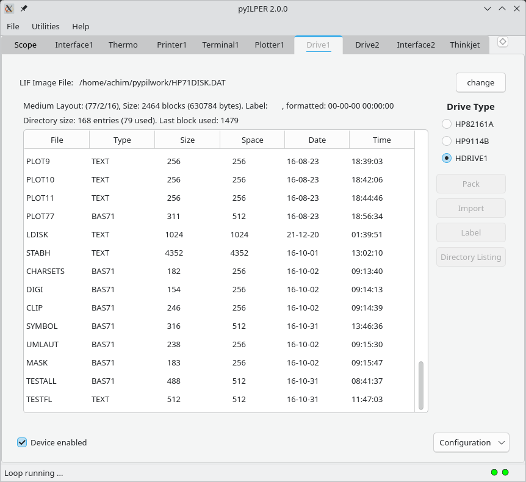

pyILPER2 (Virtual HP-IL Devices)
================================

Index
-----

* [Description](#description)
* [Features](#features)
* [Compatibility](#compatibility)
* [Installation](#installation)
* [License](#license)
* [Acknowledgements](#acknowledgements)

Description
-----------
HP-IL (Hewlett Packard Interface Loop) is a serial interconnection bus 
introduced by Hewlett-Packard in the early 1980s. It enabled the communication 
between peripheral devices such as printers, floppy disk drives, etc. 
with programmable calculators such as the HP-41C, HP71B, and HP-75C/D.

Although these devices have not been manufactured for a long time, there are still many enthusiasts who want to work with them.

Software emulations of HP-IL controllers and peripheral devices that run on a PC have been available for quite some time. More recently, 
emulations of HP-IL peripheral devices based on microcontrollers have been added. 

pyILPER version 2 offers a range of emulated HP-IL peripheral devices and is capable of running
multiple interfaces simultaneously, allowing for complex HP-IL configurations that may consist of the following components:
- Software emulated controllers/devices on the PC (EMUXX, pyILPER devices, Virtual HP-IL over TCP/IP devices)
- Good old "real" HP-IL hardware 
- The new microcontroller based devices like [TULIP4041](https://github.com/mjakuipers/TULIP-DevBoard), [JCILD](https://sites.google.com/view/jcild/home)  or [HIPI-Board](https://github.com/ecsfang/HIPI-Board) that support the HP-IL protocol

pyILPER version 2 is the successor to [pyILPER 1.x](https://github.com/bug400/pyilper/). Version 1.x is no longer being developed.

For users of Pyilper version 1.x, this [upgrade documentation](UPGRADE.md) provides a concise overview of changes.

Features
--------

* Entirely written in Python3 using the Qt GUI framework (Pyside6)
* Virtual mass storage drive with integrated directory list, file management  (import, export, rename, purge, view) and disk management functions (label, pack, initialize)
* Virtual generic printer emulating the HP-71B, HP-41C, HP-75 and ROMAN-8 character sets
* Terminal emulator with keyboard support for HP-71B and HP-75.
* Virtual plotter emulating the HP-7470A HP-IL plotter
* Virtual printer emulating the HP-82162A thermal printer
* Virtual printer emulating the ThinkJet HP-2225B printer
* HP-IL scope
* The number of virtual devices is configurable,
* The virtual devices can be either organized in a compact tabbed view or in independent floating windows
* The output of the scope or the virtual printer(s) is logged to file(s)
* Monitoring the status of the virtual HP-IL devices
* Run multiple interfaces of the following types simultaneously:
  * [PIL-Box](http://www.jeffcalc.hp41.eu/hpil/) via serial-over-USB interface
  * [Virtual HP-IL over TCP/IP](http://hp.giesselink.com/hpil.htm) (dual TCP/IP V4/V6 stack)
  * DOSBox emulated controllers [EMU41, EMU71 and EMU75](http://www.jeffcalc.hp41.eu/index.html).

See the [pyILPER virtual devices gallery](GALLERY.md) for details.

Compatibility
-------------

The minimum operating system requirements are:
- Windows 11
- Debian Trixie
- macOS 12

Installation
------------

pyILPER version 2 requires the Python interpreter, Pyside6, and the pySerial package installed. 

See the [installation Instructions](INSTALL.md) for details.

In order to use the file and disk management functions and the virtual HP7470A plotter, 
an up-to-date version of the [LIFUTILS](https://github.com/bug400/lifutils/releases) 
is required as well.

License
-------

pyILPER version 2 is published under the GNU General Public License v2.0 License 
(see the LICENSE file).

Acknowledgements
----------------

Much code was taken from ILPER for Windows (Copyright (c) 2008-2013 
J-F Garnier, Visual C++ version by Christoph Gießelink 2016). 
The terminal emulator code was taken from the pyqterm console widget written
by Henning Schroeder. The virtual TCP/IP support of pyILPER was significantly
improved by Christoph Gießelink who also provided many other improvements. The virtual HP7470A plotter engine was derived from the HP2XX software (Heinz W. Werntges, Martin Kroeker). Parts of the HP82162A printer emulation were taken from Eric Smith's Nonpareil emulator.
